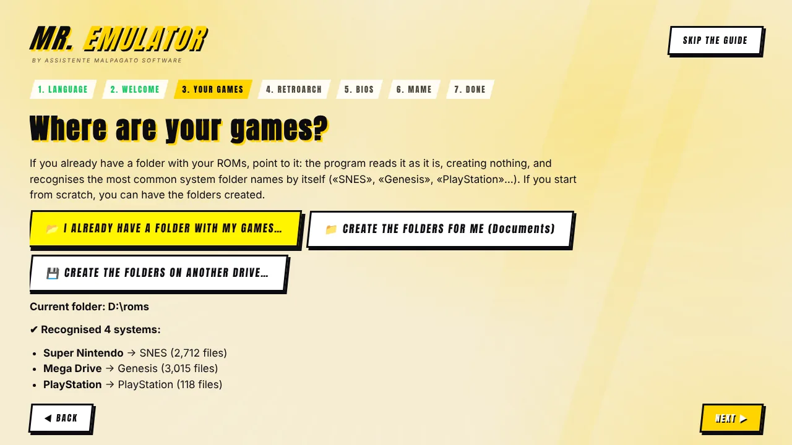
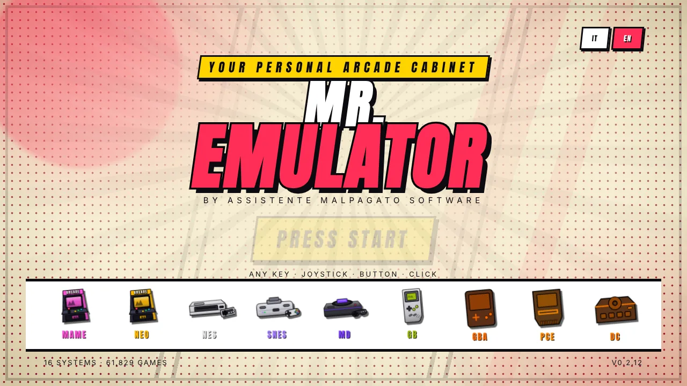
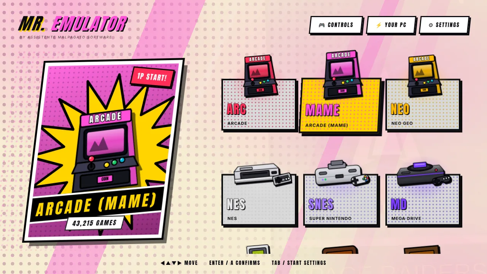

[◀ Home](Home) · **Getting started**

# 🚀 Getting started

 

## 1. Install

1. Download `Mr-Emulator-Setup-<version>.exe` from the [latest release](https://github.com/AssistenteMalpagato/Mr.Emulator/releases/latest).
2. Run it. Windows may show *"Windows protected your PC"* because the app is not signed with a paid certificate yet — click **More info → Run anyway**.
3. Start Mr. Emulator. The **first-run guide** opens by itself.

## 2. The first-run guide, step by step

| Step | What it does | What you do |
|---|---|---|
| **Language** | You choose **Italiano** or **English**; the whole guide and the program continue in that language. | Pick one (you can change it any time in Settings). |
| **Games folder** | **Reads the folder you already have** — nothing is created, moved or deleted — and recognises system folders by common names («SNES», «Genesis», «PlayStation»…). Or creates a ready-made structure in `Documents\MrEmulator` or on another drive. | Choose *I already have a folder with my games*, or let it create the folders if you start from scratch. |
| **RetroArch** | Looks for `retroarch.exe` in the usual places and offers it. | If it is not found, get it from [retroarch.com](https://www.retroarch.com/) (Windows 64-bit, just extract it) and click **Browse**. |
| **Cores** | One click downloads the cores you need from the official libretro archive. | Tick the systems you use. |
| **BIOS** | Shows a checklist with the files each system needs and verifies known ones by checksum. | Copy missing BIOS files into the `bios` folder. |
| **MAME** *(optional)* | Looks for `mame.exe` and shows its version. | Use the **same MAME version as your ROM set** — see below. |

You can skip the guide and run it again any time from the bottom of **Settings**.

> ⚠️ **MAME and your ROM set must match.** A ROM set is only valid for the MAME version it was built for (a 0.229 set needs MAME 0.229). Mr. Emulator warns you when the ROM folder name and the MAME version differ. Official releases (including old ones) are on [mamedev.org](https://www.mamedev.org/release.html).

## 3. Play

1. On the title screen press any key, click, or press a joystick button.
2. Pick a system with the arrows (or mouse / pad).
3. Pick a game. The right side shows the cover, the title and — if there is a save — the **Continue / New game** switch.
4. **Enter** (or button 1) to launch. Exit with **Esc**, or **Select + Start** on a gamepad.

 

## 4. Make it yours

- **Settings → Look** — comic or stage style, theme colours, your own console photos.
- **Settings → Systems on home** — hide the systems you do not use.
- **Settings → Covers** — download covers for a whole system with one click.
- **Your PC** — see what the program detected and force a performance level if you want.

## Something not working?

Open **Settings → Diagnostics**. It checks folders, cores, BIOS files and RetroArch's last log, and tells you what to do. See [Troubleshooting](Troubleshooting).

[Next: Features tour ▶](Features)
